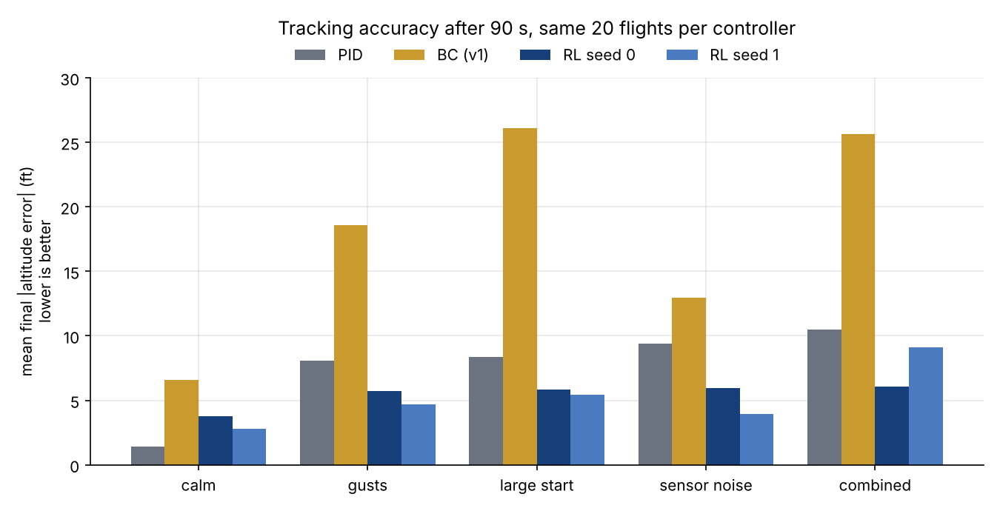
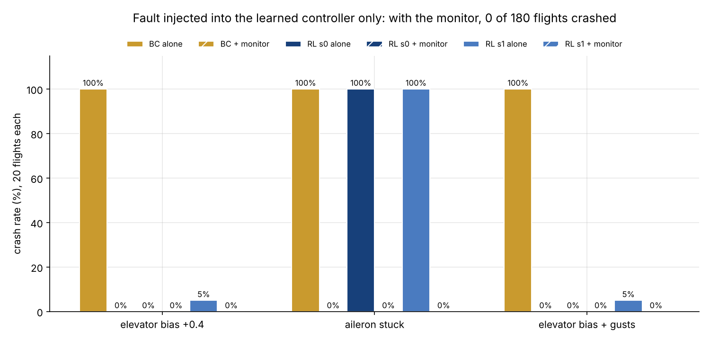
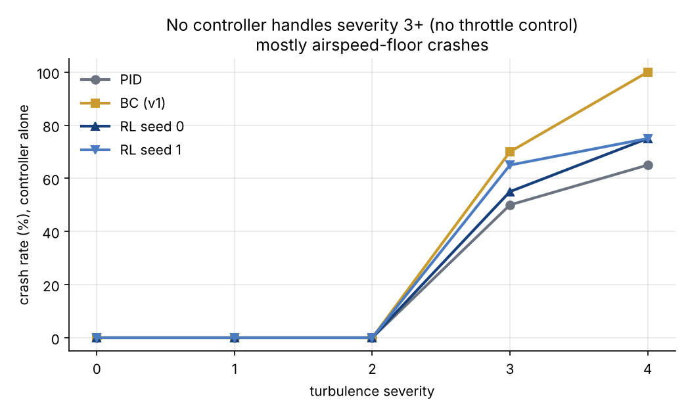

# Safe Autopilot

### Godwin Pammichukwu Emefiele Jr

A learned flight controller with a runtime safety monitor, built from public tools only
(Python, [JSBSim](https://jsbsim.org/), [Gymnasium](https://gymnasium.farama.org/), [PyTorch](https://pytorch.org/),
[Stable-Baselines3](https://stable-baselines3.readthedocs.io/)). Flown in a JSBSim Cessna 172 simulation.

**The idea:** put a learned controller under a monitor that watches the aircraft's state in real
time and hands control to a simple, known-safe PID the moment the learned controller leaves a
safe envelope. **v1** learns by imitating the PID (behavior cloning). **v2** learns by
reinforcement learning (PPO). The monitor and the PID fallback are identical in both.

📄 One-page writeup: [`WRITEUP.pdf`](WRITEUP.pdf) — what broke while building this, how each problem was found, and how it was resolved or bounded.

---

## Why this exists

Learned controllers can look great in validation and still fail in ways that are hard to
predict ahead of time. This project builds the smallest possible version of the pattern
used to make that safe in practice: **a simple, well-understood fallback controller, and
a monitor with an evidence-based envelope, watching a more capable but less predictable
learned controller.** Every threshold and design choice below is backed by a plot or a
number from this repo, including where it *didn't* work as planned.

## Architecture

```
                    ┌─────────────────┐
   state ──────────▶│  Safety Monitor  │
                    └────────┬─────────┘
                             │ envelope OK?
                 ┌───────────┴───────────┐
                 │ yes                   │ no (latches for
                 ▼                       │  rest of episode)
        ┌──────────────────┐             ▼
        │  Learned policy    │   ┌──────────────────┐
        │  v1: BC   v2: PPO  │   │   PID fallback     │
        └──────────────────┘   └──────────────────┘
                 │                       │
                 └───────────┬───────────┘
                              ▼
                    JSBSim C172 simulation
```

## Results

All v2 results below use **JSBSim 1.2.4** and 20 identical flights per cell (90 s each, v1's conditions: heading
changes up to ±40°, turbulence severity 2 unless noted, sensor noise, altitude offsets up to ±150 ft). v2 was
trained with two random seeds; both are shown.

### v1 → v2: tracking

Mean final altitude error (ft, lower is better):

| Condition | PID | BC (v1) | RL seed 0 | RL seed 1 |
|---|---|---|---|---|
| calm | **1.4** | 6.6 | 3.8 | 2.8 |
| gusts (sev 2) | 8.1 | 18.6 | 5.7 | **4.7** |
| large off-nominal start | 8.3 | 26.1 | 5.9 | **5.4** |
| sensor noise | 9.4 | 12.9 | 6.0 | **4.0** |
| combined stress | 10.5 | 25.6 | **6.1** | 9.1 |



RL beats the behavior-cloned model in every condition, and beats the PID in every disturbed condition for both
seeds. The PID is still best in calm air (the RL policy has no integral term, so it settles a few feet off).
Alone, the RL policies crashed in 2 of their 200 flights across these five conditions (both in combined
stress, seed 1); with the monitor engaged, none crashed.

### Fault injection: where the monitor earns its place

A fault is injected into the **learned controller's output only**; the PID fallback is never faulted.

| Fault | BC alone | RL alone (2 seeds) | With monitor |
|---|---|---|---|
| elevator command biased +0.4 | 100% crash | 0% / 5% | 0% crash, caught in ≈1 s |
| aileron stuck at +0.3 | 100% crash | 100% / 100% | 0% crash, caught in ≈1.5 s |
| elevator bias + gusts | 100% crash | 0% / 5% | 0% crash |



0 of 180 monitored flights crashed. Fault types and sizes were chosen by me; they are a stress test, not a
model of any real failure mode.

### The limit nothing here fixes



None of the controllers manages throttle, so a bank plus a gust can bleed airspeed through the stall floor.
Every controller, including the RL policies and the PID fallback itself, is reliable up to turbulence severity 2
and crashes 50–100% of flights at severity 3–4 (mostly airspeed-floor crashes). Because the fallback shares
this limit, the monitor cannot help there. A throttle loop is the obvious next step.

### v1 results


The imitation model tracks the PID almost exactly for the first ~20 s, then drifts into a slow oscillation. The
monitor catches it at t≈31 s and the aircraft recovers under PID control. Left alone, the same flight is still
diverging at t=120 s. In v1's stress test the monitor cut final altitude error by 2–3× versus the model alone
(e.g. large off-nominal start: 18.7 ft → 6.2 ft), and no monitored flight crashed.


## What went wrong (worth reading)

The one-page [`WRITEUP.pdf`](WRITEUP.pdf) covers these in detail. The short version:

1. **Heading-wrap discontinuity.** Crossing 360°/0° produced a 358° error instead of 2°.
2. **Deterministic turbulence.** Every training episode got an identical gust pattern until
   `atmosphere/randomseed` was explicitly randomized.
3. **The imitation model loses the PID's integral memory.** Fine at a 60 s horizon, a slow
   oscillation by 120 s. This is the reason the monitor exists, not a bug to patch away.
4. **The PID mis-trims when engaged mid-flight** as a fallback. Found only by integration-testing the full
   monitor + fallback system.
5. **The fallback has no airspeed protection.** A characterized limit (see plot above).
6. **The RL reward taught the policy to crash on purpose.** The first reward had an unbounded per-step penalty and a flat
   -50 crash penalty, so once a rollout started to diverge, ending the episode was cheaper than continuing.
   Mean episode length collapsed from ~400 steps to ~25 and stayed there. It was only noticed by reading the
   full training curve rather than trusting that training "finished". Fixed by capping the per-step penalty
   and adding a per-step alive bonus (the standard fix in benchmark environments such as Hopper/Ant). My
   pre-training reward check had tested a perfect flight and an instant crash, but not a slow, mediocre
   divergence, which is exactly where it broke.
7. **Results depend on the simulator version.** On JSBSim 1.3.3 the PID alone never crashed at turbulence severity
   3–4; on 1.2.4 it crashes 50–65% of the time. I only found this because re-running the stress test in a fresh
   environment with a newer JSBSim failed to reproduce my earlier numbers. Pin the version (see below).

## Repo structure

| File | What it does |
|---|---|
| `flight_env.py` | Gymnasium environment wrapping JSBSim's C172 (state, actions, turbulence, v2 reward) |
| `pid_controller.py` | Cascaded altitude/heading-hold PID: the safe baseline and fallback |
| `bc_model.py` / `bc_policy.pt` | v1: small MLP trained to imitate the PID |
| `safety_monitor.py` | Runtime envelope monitor with latching fallback to the PID |
| `domain_randomization.py`, `train_ppo.py` | v2: randomized training conditions and PPO training |
| `check_reward.py` | Sanity checks for the reward function (good flight, mediocre flight, crash) |
| `v1_vs_v2.py` | v1-vs-v2 comparison and PID-reliability sweep (same episodes for every controller) |
| `faults_v2.py` | Fault-injection test |
| `models/ppo_seed0.zip`, `models/ppo_seed1.zip` | Trained PPO policies |
| `pid_dataset.npz` | 300 episodes / 360k (state, action) pairs used to train the v1 model |
| `step1_fly.py` … `step7_stress_test.py` | The v1 build, in order |

## Quickstart

```bash
python -m venv .venv && source .venv/bin/activate
pip install jsbsim==1.2.4 gymnasium numpy matplotlib torch stable-baselines3   # pin JSBSim: results change across versions

python step3_pid_eval.py      # verify the PID baseline
python step6_monitor_eval.py  # v1: see the monitor catch a drifting model
python train_ppo.py --n-envs 4 --total-steps 500000 --run-name ppo   # v2: train (~15–20 min on a few cores)
python v1_vs_v2.py --part main --out cmp_main.json
python faults_v2.py
```

(`v1_vs_v2.py` expects the trained policies at `runs/ppo_v2/final_model.zip` and `runs/ppo_v2_seed1/final_model.zip`; adjust the paths if you use `models/`.)

## Limitations

- **Two training seeds and 20 flights per cell.** Differences of a few feet in calm conditions are within noise.
  Crash counts are 0–2 flights per cell.
- **Version mismatch.** The PPO policies were trained on JSBSim 1.3.3 and evaluated on 1.2.4. They held up, but
  retraining on 1.2.4 would be cleaner.
- **The monitor is conservative for RL.** The RL policy banks harder in 40° turns than the PID does and trips the
  monitor in 50–60% of calm-air flights (on the 30° bank limit, in the diagnostic I ran), so "RL + monitor" is often the PID for part
  of the flight. The thresholds were tuned in v1 for the imitation model.
- **Simulation only.** Single-engine C172 model, simplified sensors, no actuator dynamics or latency.

## Status

- [x] **v1**: PID baseline, behavior-cloned imitation model, safety monitor, stress test
- [x] **v2**: PPO-trained policy behind the same monitor and fallback, with fault injection
- [ ] Demo video
- [ ] Throttle / airspeed control (removes the turbulence cliff)

## Built with

Python · [JSBSim](https://jsbsim.org/) · [Gymnasium](https://gymnasium.farama.org/) · [PyTorch](https://pytorch.org/) · [Stable-Baselines3](https://stable-baselines3.readthedocs.io/)
