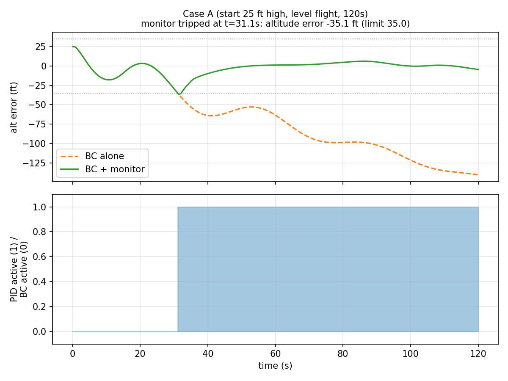
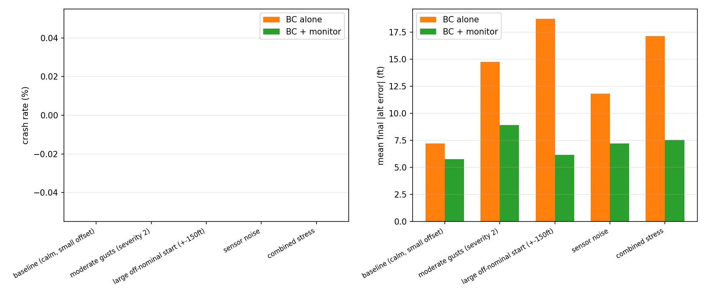
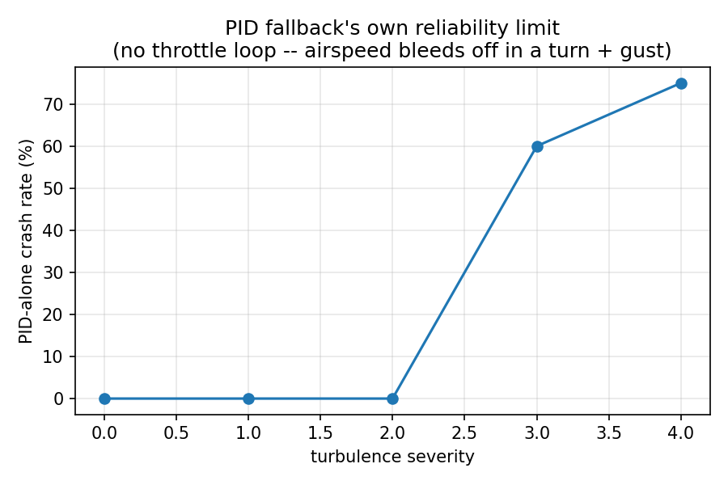

# Safe Autopilot

### Godwin Pammichukwu Emefiele Jr

A learned flight controller with a runtime safety monitor, built from public tools only
(Python, [JSBSim](https://jsbsim.org/), [Gymnasium](https://gymnasium.farama.org/), [PyTorch](https://pytorch.org/)).
Flown in a JSBSim Cessna 172 simulation.

**The idea:** train a neural network to imitate a PID controller, then wrap it with a
monitor that watches the aircraft's state in real time and hands control back to the
(known-safe) PID the moment the learned controller starts behaving unsafely.

📄 One-page writeup: [`WRITEUP.pdf`](WRITEUP.pdf) — five real bugs found while building this, each with root cause and fix.

---

## Why this exists

Learned controllers can look great in validation and still fail in ways that are hard to
predict ahead of time. This project builds the smallest possible version of the pattern
used to make that safe in practice: **a simple, well-understood fallback controller, and
a monitor with an evidence-based envelope, watching a more capable but less predictable
learned controller.** Every threshold and design choice below is backed by a plot or a
number from this repo, not a guess — including where it *didn't* work as planned.

## Architecture

```
                    ┌─────────────────┐
   state ──────────▶│  Safety Monitor  │
                    └────────┬─────────┘
                             │ envelope OK?
                 ┌───────────┴───────────┐
                 │ yes                   │ no (latches for
                 ▼                       │  rest of episode)
        ┌──────────────────┐             ▼
        │  Learned policy    │   ┌──────────────────┐
        │  (BC now, RL in v2)│   │   PID fallback     │
        └──────────────────┘   └──────────────────┘
                 │                       │
                 └───────────┬───────────┘
                              ▼
                    JSBSim C172 simulation
```

## Results

**The monitor catches a drifting model mid-flight and hands off cleanly:**



The imitation model tracks the PID almost exactly for the first ~20s, then drifts into a
slow oscillation (see [why](#what-went-wrong-worth-reading), below). The monitor catches
it at t≈33s and the aircraft recovers under PID control. Left alone, the same flight is
still diverging at t=120s.

**Stress test — 0% crash rate with the monitor vs. up to 40% without it, in every
condition tested:**



**The PID fallback's own reliability limit, characterized independently of the model:**



No throttle loop means a bank plus a gust can bleed airspeed past the stall floor with
nothing to stop it — reliable up to turbulence severity 2, degrading sharply above that.
This is a known, documented scope limit of v1's fallback controller (see writeup).

## What went wrong (worth reading)

The one-page [`WRITEUP.pdf`](WRITEUP.pdf) covers all five in detail — the short version:

1. **Heading-wrap discontinuity** — crossing 360°/0° produced a 358° error instead of 2°.
2. **Deterministic turbulence** — every training episode got an identical gust pattern
   until `atmosphere/randomseed` was explicitly randomized.
3. **The imitation model loses the PID's integral memory** — looks fine at a 60s eval
   horizon, diverges into a slow oscillation by 120s. This is the reason the monitor
   exists, not a bug to patch away.
4. **The PID mis-trims when engaged mid-flight** as a fallback, not just at a fresh
   reset — found only by integration-testing the full monitor+fallback system.
5. **The fallback has no airspeed protection** — a real, characterized limit (see plot
   above), not something a monitor can compensate for by picking a different controller.

## Repo structure

| File | What it does |
|---|---|
| `flight_env.py` | Gymnasium environment wrapping JSBSim's C172 (state, actions, turbulence) |
| `pid_controller.py` | Cascaded altitude/heading-hold PID — the safe baseline and fallback |
| `bc_model.py` / `bc_policy.pt` | Small MLP trained to imitate the PID (behavior cloning) |
| `safety_monitor.py` | Runtime envelope monitor with latching fallback to the PID |
| `pid_dataset.npz` | 300 episodes / 360k (state, action) pairs used to train the model |
| `step1_fly.py` … `step7_stress_test.py` | The build, in order — see below |

## Quickstart

```bash
python -m venv .venv && source .venv/bin/activate
pip install jsbsim gymnasium numpy matplotlib torch

python step3_pid_eval.py      # verify the PID baseline
python step5_train.py         # train the imitation model (or use the included bc_policy.pt)
python step6_monitor_eval.py  # see the monitor catch a drifting model
python step7_stress_test.py   # full stress-test sweep
```

Each script prints a results table and saves its plots alongside itself.

## Status

- [x] **v1** — PID baseline, behavior-cloned imitation model, safety monitor, stress test
- [ ] **v2** — replace the imitation model with one trained via reinforcement learning,
      same monitor and fallback

## Built with

Python · [JSBSim](https://jsbsim.org/) · [Gymnasium](https://gymnasium.farama.org/) · [PyTorch](https://pytorch.org/)
